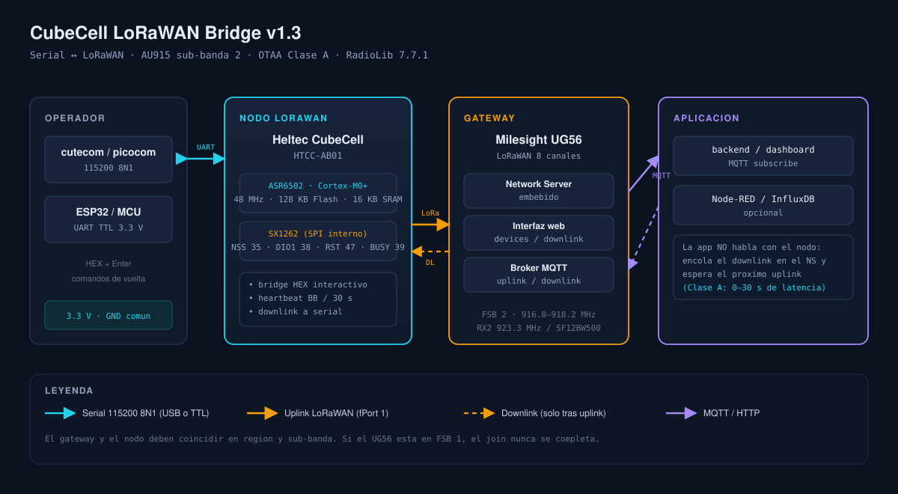
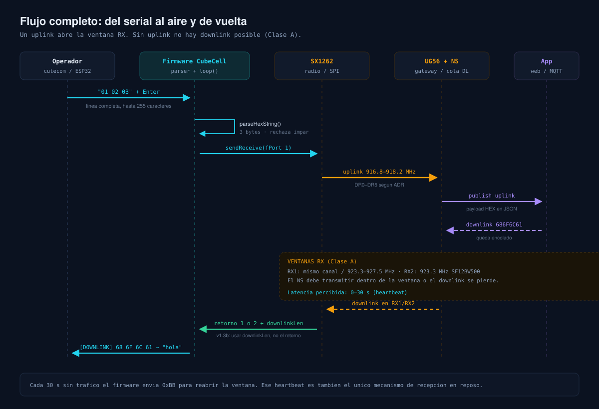
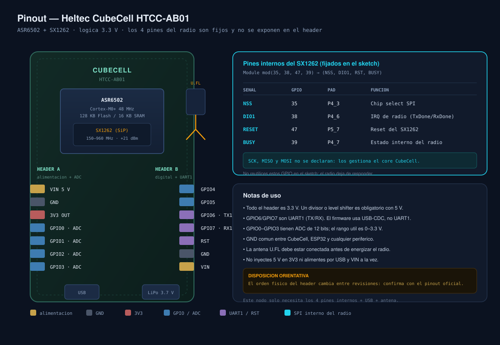

<div align="center">

# CubeCell LoRaWAN Bridge v1.3

**Un puente bidireccional entre un puerto serie y la red LoRaWAN.**
Escribes HEX por el puerto serie y sale al aire. El gateway responde y el comando aparece en tu terminal.

<br>


</div>

---

> **En una frase:** la CubeCell convierte el puerto serie en un socket de bytes sobre LoRaWAN, y convierte los downlinks del gateway en líneas de texto que cualquier microcontrolador o terminal puede leer.

Un único sketch (~330 líneas) y la documentación para reproducirlo. Sin backend ni dashboard: la pieza mínima entre «tengo un gateway» y «puedo mandar bytes desde un equipo que solo habla UART».

---

## Tabla de contenidos

- [Qué es este proyecto](#qué-es-este-proyecto)
- [Estado y alcance](#estado-y-alcance)
- [Principio de funcionamiento](#principio-de-funcionamiento)
- [Topología](#topología)
- [Modos de operación](#modos-de-operación)
- [Downlink desde la web y desde MQTT](#downlink-desde-la-web-y-desde-mqtt)
- [Pinout](#pinout)
- [Diagrama de conexión](#diagrama-de-conexión)
- [Requisitos](#requisitos)
- [Instalación del entorno](#instalación-del-entorno)
- [Configuración OTAA](#configuración-otaa)
- [Compilación y carga](#compilación-y-carga)
- [Verificación por puerto serie](#verificación-por-puerto-serie)
- [Formato de payload](#formato-de-payload)
- [Seguridad](#seguridad)
- [Rendimiento, airtime y duty cycle](#rendimiento-airtime-y-duty-cycle)
- [Solución de problemas](#solución-de-problemas)
- [Limitaciones conocidas](#limitaciones-conocidas)
- [Cómo se construyó](#cómo-se-construyó)
- [Estructura del repositorio](#estructura-del-repositorio)
- [Referencias](#referencias)
- [Licencia](#licencia)

---

## Qué es este proyecto

Un **nodo LoRaWAN de propósito general** que no mide nada por sí mismo. No tiene sensor de temperatura, ni GPS, ni relé. Su responsabilidad es transportar bytes entre un puerto serie y la red LoRaWAN en ambas direcciones: escribes una línea HEX y se transmite como uplink en `fPort 1`; el downlink encolado se recibe en la ventana RX y se imprime como `[DOWNLINK] 68 6F 6C 61 → "hola"`. Cada 30 s sin tráfico envía `0xBB` para reabrir la ventana de recepción.

Eso lo vuelve reutilizable: cualquier equipo con UART —un ESP32, un Arduino, una Raspberry Pi, un PLC, un medidor viejo— puede conectarse y obtener conectividad LoRaWAN de largo alcance sin saber nada de OTAA ni de ventanas de recepción. Del otro lado, el gateway publica esos bytes por MQTT y acepta comandos de vuelta. Nació de una necesidad concreta: enviar comandos a un equipo remoto que solo tenía puerto serie, en un sitio sin WiFi ni cobertura celular útil, con un gateway LoRaWAN ya instalado. La alternativa era un módulo transparente comercial; este firmware ganó porque permite controlar el tamaño del payload, la cadencia del heartbeat y el formato de salida por serie.

**No hace:** no duerme, no persiste la sesión ni el `DevNonce`, no fragmenta payloads (51 bytes es el techo), no autentica comandos de aplicación y no tiene OTA.

---

## Estado y alcance

**Prototipo funcional, validado en hardware real.** No es un producto ni una librería.

Funcional y validado en hardware: join OTAA, uplink interactivo, downlink (desde v1.3b) y heartbeat. **No implementado:** persistencia de sesión/`DevNonce`, separación de credenciales (las claves viven en el `.ino`), confirmación de uplinks y pruebas automatizadas; la verificación es manual por puerto serie. La versión `v1.3b` es la de este repositorio; el sufijo corresponde a la corrección de `sendReceive()` ([detalle](#cómo-se-construyó)).

---

## Principio de funcionamiento

### LoRa: la capa física

LoRa es una modulación de **espectro ensanchado por chirp** (CSS). En vez de una portadora estable, el transmisor barre la banda con un chirp cuya frecuencia sube linealmente. El receptor correlaciona la señal con la réplica del chirp: una señal **20 dB por debajo del ruido** sigue siendo correlacionable, porque el ruido no tiene esa estructura.

| Parámetro | Qué controla | Efecto práctico |
|---|---|---|
| **SF** (7–12) | Chips por símbolo (`2^SF`) | Más SF = más alcance y **más tiempo en el aire** |
| **BW** (125/250/500 kHz) | Ancho de banda del chirp | Más BW = más velocidad, menos sensibilidad |
| **CR** (4/5–4/8) | Redundancia FEC | Más redundancia = más robustez y airtime |

La relación no es lineal: de SF7 a SF12 el tiempo de símbolo se multiplica por 32, y un payload de 13 bytes pasa de ~51 ms a ~1155 ms. Eso define cuántos nodos caben en un gateway y cuánta batería consume cada mensaje. El presupuesto de enlace ronda los **155 dB** (+21 dBm de TX, -137 dBm en SF12): cada 6 dB duplican la distancia en espacio libre, pero en interiores las paredes se comen ese margen rápido.

**AU915** tiene una particularidad: los uplinks viven entre 915.2 y 927.8 MHz, con 64 canales de 125 kHz y 8 de 500 kHz, agrupados en **sub-bandas (FSB)** de 8 canales. Este nodo usa **FSB 2**: 916.8 a 918.2 MHz, paso de 200 kHz. El gateway *debe* estar en la misma sub-banda; si está en FSB 1, el nodo transmite donde nadie escucha y el join nunca se completa.

### LoRaWAN: la capa de red

Es el protocolo MAC sobre LoRa. Define identidades, seguridad, activación, puertos y clases:

- **Identidades.** `DevEUI` (64 bits, único), `JoinEUI`/`AppEUI` (servidor de join) y `AppKey` (128 bits, secreta). En 1.0.x hay una sola `AppKey`; en 1.1 se separa en `NwkKey` y `AppKey`. El sketch declara ambas con el mismo valor: correcto para 1.0.x, **incorrecto** para 1.1.
- **OTAA y seguridad.** El nodo envía un `JoinRequest` firmado con la `AppKey`; el `JoinAccept` trae un `JoinNonce` del que se derivan `NwkSKey` (MIC) y `AppSKey` (cifrado AES-CTR). El payload viaja cifrado y autenticado con un MIC de 4 bytes.
- **Contadores y puertos.** Cada uplink lleva un contador de 32 bits que no debe repetirse con la misma clave; si se repite, el servidor lo descarta. `fPort 0` es para comandos MAC y `1–223` para aplicación: este firmware usa **`fPort 1`** para todo. El servidor puede ajustar el SF vía ADR; el sketch no lo desactiva.

### Por qué Clase A importa aquí

En **Clase A** el nodo solo escucha en dos ventanas cortas después de transmitir:

```
        uplink                      RX1                 RX2
  ────────────────►  ...  ─────► (1 s) ─────►  ...  ─────► (2 s)
```

- **RX1** se abre ~1 s después del uplink, en el canal de downlink correspondiente (923.3–927.5 MHz en AU915).
- **RX2** se abre ~2 s después, siempre en **923.3 MHz con SF12/BW500** (DR8).

Fuera de esas ventanas el radio está apagado y **es físicamente imposible recibir nada**. Eso explica el 90 % de las confusiones con downlinks: si el servidor envía cuando el nodo no escucha, el paquete se pierde o queda encolado hasta el próximo uplink. Por eso existe el heartbeat de 30 s: no es telemetría, es **la señal que abre la puerta para recibir órdenes**.

---

## Topología

```
 Terminal ──UART 115200──► CubeCell HTCC-AB01 ──LoRa──► UG56 ──MQTT──► Backend
 (cutecom/ESP32) ◄────────  (ASR6502 + SX1262)  ◄─DL──  (NS embebido)
                           fPort 1 · FSB 2        downlink encolado
```



Hay dos caminos que se cruzan en el gateway:

1. **Datos:** el nodo transmite, el UG56 demodula, su NS embebido valida MIC y contadores, descifra y publica el payload en MQTT (normalmente HEX dentro de un JSON).
2. **Control:** la aplicación publica o envía por la web un downlink al `DevEUI`; el NS lo **encola** y lo entrega en la próxima ventana RX. El nodo lo imprime por serie y el equipo conectado decide qué hacer.

La aplicación nunca habla con el nodo: habla con el servidor de red, que espera a que el nodo pregunte. Esa inversión es la esencia de Clase A y la razón de ser del heartbeat.

---

## Modos de operación

### Modo 1 — Bridge interactivo

Escribes una línea HEX terminada en `Enter` y el firmware la transmite:

```
> 01 02 03
>> Enviando: 01 02 03 → OK (sin downlink)
>
```

El parser **descarta todo lo que no sea dígito hexadecimal** antes de convertir: `01 02 03`, `010203` y `01:02:03` son equivalentes; `0x01 0x02` no (la `x` se descarta y la longitud queda impar). Dos reglas no obvias: **no hay prefijo `0x`** y **no hagas pausas de más de 500 ms** al escribir (el buffer se descarta por inactividad). La tabla completa está en [Formato de payload](#formato-de-payload).

### Modo 2 — Heartbeat automático

Cada 30 s sin uplinks envía un byte `0xBB`. Su única función es abrir la ventana RX para que el servidor entregue lo que tenga encolado.

```
[HEARTBEAT] >> Enviando: BB → OK (sin downlink)
```

Cualquier uplink manual reinicia el temporizador. El heartbeat solo corre si hay sesión activa; si el join falló al arrancar, **no hay reintento automático** y el nodo queda sordo hasta que envíes una línea.

### Modo 3 — Recepción de downlink

Cuando llega un comando se imprime en el mismo puerto, con hex y ASCII:

```
[DOWNLINK] 68 6F 6C 61  →  "hola"
[DOWNLINK] 01 0A 01  →  "..."
```

El formato está pensado para ser parseado por una máquina: el prefijo `[DOWNLINK] ` es un delimitador estable y la línea termina en `\n`.



### Modo 4 — Re-join

Si la sesión se perdió, el firmware intenta recuperarla antes de transmitir:

```
[REJOIN] Intentando re-join...
[REJOIN] +++ EXITOSO +++
```

Si falla, reporta el código y el nombre (`-1116 (NO_JOIN_ACCEPT)`) y reintenta una vez tras 5 s; no hay reintento indefinido en segundo plano porque el diseño prioriza no bloquear el puerto serie.

---

## Downlink desde la web y desde MQTT

Un downlink no se "envía al nodo": se **encola en el Network Server** y se entrega en la próxima ventana RX. Si el nodo transmite cada 30 s, la latencia máxima es 30 s. Si acabas de enviar un comando manual, la ventana ya se abrió y puede llegar de inmediato.

### Opción A — Interfaz web del UG56

El menú cambia entre versiones de firmware, pero el flujo es siempre el mismo: entra a la interfaz web del gateway (en los ejemplos, `https://192.0.2.10`), ve a **LoRa → Network Server → Device**, selecciona el dispositivo por su `DevEUI`, pulsa **Send Downlink** y completa:

| Campo | Valor | Por qué |
|---|---|---|
| **Payload (hex)** | `686F6C61` | Bytes crudos, sin `0x` |
| **Port** | `1` | El nodo transmite en `fPort 1` |
| **Confirmed** | `false` | Un downlink confirmado genera otro uplink y consume airtime |
| **Class** | `A` | El nodo no escucha fuera de las ventanas RX |

Envía y espera: como máximo 30 s después aparece `[DOWNLINK] 68 6F 6C 61  →  "hola"`.

### Opción B — MQTT

Los *topics* dependen de la configuración del NS. Un esquema típico —y el que usa el proyecto— es:

| Dirección | Topic | Payload |
|---|---|---|
| Uplink | `<PREFIJO>/uplink/<DevEUI>` | JSON con el payload en HEX |
| Downlink | `<PREFIJO>/downlink/<DevEUI>` | HEX crudo |

```bash
mosquitto_pub -h 192.0.2.20 -p 1883 \
  -u '<USUARIO_MQTT>' -P '<PASSWORD_MQTT>' \
  -t '/downlink/<DevEUI>' -m '686F6C61'

mosquitto_sub -h 192.0.2.20 -t '/uplink/<DevEUI>' -v
```

> `192.0.2.x` pertenece al rango reservado para documentación (RFC 5737). Reemplázalo por tus IPs reales y **nunca** publiques credenciales MQTT ni EUIs reales.

### Downlinks de ejemplo

`686F6C61` imprime `[DOWNLINK] 68 6F 6C 61  →  "hola"`; `01` imprime `[DOWNLINK] 01  →  "."`. Los downlinks de 1 byte con valores bajos (`00`, `03`, `06`) muchas veces no son tuyos: son respuestas MAC del NS (`LinkCheckAns`, `DevStatusAns`, ajustes de ADR). El firmware los imprime igual porque no filtra; si tu integración los confunde, filtra por longitud o por un byte de cabecera propio. [`docs/developer.md`](docs/developer.md) trae un ejemplo de tres líneas.

---

## Pinout

### Pines internos del SX1262 (los que usa el firmware)

Están cableados dentro del módulo y **no** salen al header. Son los únicos que el sketch declara:

```cpp
Module mod(35, 38, 47, 39);   // (NSS, DIO1, RST, BUSY)
SX1262 radio(&mod);
```

| Señal | GPIO | Pad | Función | Si se cambia mal |
|---|---|---|---|---|
| **NSS** | **35** | `P4_3` | Chip select SPI | `CHIP_NOT_FOUND` |
| **DIO1** | **38** | `P4_6` | IRQ de radio | El stack espera eventos que no llegan |
| **RESET** | **47** | `P5_7` | Reset del transceptor | Estado indefinido |
| **BUSY** | **39** | `P4_7` | Estado interno | Lecturas SPI corruptas |

`SCK`, `MISO` y `MOSI` no se declaran: los configura el core. En la HTCC-AB01 el SX1262 es un **SiP** junto al ASR6502, así que no hay cables que conectar ni pines que equivocar: si el sketch dice `Radio OK`, el bus está bien.



### Header de expansión

La **disposición física exacta cambia entre revisiones**, así que la tabla describe la asignación lógica, no el orden de los pines:

| Pin | GPIO | Tipo | Función | Uso aquí |
|---|---|---|---|---|
| `VIN` | — | Alimentación | 5 V / USB | Alimentación |
| `GND` | — | Alimentación | Referencia común | **Obligatorio** con periféricos |
| `3V3` | — | Alimentación | Salida 3.3 V | Sensores de bajo consumo |
| `GPIO0`–`GPIO3` | 0–3 | Digital / ADC | ADC 12 bits | Libre |
| `GPIO4`–`GPIO5` | 4–5 | Digital | GPIO / PWM | Libre |
| `GPIO6` | 6 | UART | `Serial1` TX | Libre (no usado) |
| `GPIO7` | 7 | UART | `Serial1` RX | Libre (no usado) |
| `RST` | — | Reset | Reset del ASR6502 | Libre |

> **Nota de verificación:** la matriz de funciones alternativas (I2C, SPI, PWM) depende del core y de la revisión; contrasta con el pinout oficial antes de cablear. Este proyecto solo depende de los cuatro pines internos del radio, estables entre revisiones.

### Puerto serie

| Parámetro | Valor |
|---|---|
| Interfaz | USB de la placa (`/dev/ttyUSB0` o `/dev/ttyACM0`) |
| Baudrate | **115200** |
| Formato | 8N1, sin control de flujo |
| Fin de línea | `\n` o `\r` (ambos procesan) |
| Prompt | `> ` |

> ⚠️ **Integración por TTL:** el sketch usa `Serial`, que en la HTCC-AB01 sale por el conector USB. `GPIO6`/`GPIO7` son `Serial1` y **no** reciben copia de lo que imprime el firmware. Para conectar un ESP32 por TTL hay que cambiar `Serial` por `Serial1` (sustitución global) y cablear TX→RX, RX→TX y GND. El procedimiento está en [`docs/developer.md`](docs/developer.md).

---

## Diagrama de conexión

### Montaje mínimo

```
 PC (cutecom 115200) ──USB──► CubeCell HTCC-AB01 ──U.FL──► antena 915 MHz
```

1. Conecta la **antena** al U.FL **antes** de energizar. Transmitir sin antena puede dañar la etapa de RF.
2. Conecta el USB: la placa aparece como puerto serie.
3. Abre el monitor a 115200 8N1 y verifica el join; cuando aparezca `> `, puedes enviar HEX.

### Integración con un microcontrolador

Conecta `GPIO6` (TX1) → RX del otro equipo, `GPIO7` (RX1) ← TX, y **GND común**. Requiere cambiar `Serial` por `Serial1` en el sketch; el procedimiento está en [`docs/developer.md`](docs/developer.md). Reglas que no se negocian:

- **GND común siempre.** Sin referencia común, el UART lee basura.
- **Nunca 5 V en los GPIO.** El ASR6502 no es tolerante; con un Arduino UNO hace falta divisor o level shifter.
- **No alimentes por USB y por `VIN` a la vez** si no conoces el OR-ing de tu revisión.
- **Cables cortos** (< 30 cm) a 115200 baudios.

### Conexión al gateway

No hay cables: la conexión es administrativa.

| Elemento | Debe coincidir |
|---|---|
| Región | **AU915** en nodo y gateway |
| Sub-banda | **FSB 2** (916.8–918.2 MHz) en ambos |
| `DevEUI` / `JoinEUI` / `AppKey` | Idénticos en sketch y servidor |
| Perfil | LoRaWAN 1.0.3/1.0.4, Clase A, OTAA |
| Puerto | `1` |

Si el gateway está en FSB 1 y el nodo en FSB 2, el síntoma es siempre `Join FAILED` sin ningún error de radio: no se detecta desde el nodo y hay que revisar el gateway.

---

## Requisitos

| Hardware | Detalle | ¿Imprescindible? |
|---|---|---|
| Heltec CubeCell **HTCC-AB01** | ASR6502 + SX1262, 128 KB Flash, 16 KB SRAM | Sí |
| Antena LoRa **915 MHz** U.FL | 2–3 dBi típicos | Sí |
| Cable USB de datos | Muchos cables son solo de carga | Sí |
| Gateway AU915 con NS | Milesight UG56 u otro con FSB 2 | Sí |
| PC con USB | Linux, macOS o Windows | Sí |
| Fuente 5 V o LiPo 3.7 V | Operación desatendida | No |
| Adaptador USB-TTL 3.3 V | Solo integración UART | No |

| Software | Versión | Nota |
|---|---|---|
| `arduino-cli` | ≥ 0.35 | También sirve el IDE |
| Core **CubeCell** (Heltec) | última estable | Aporta el `FQBN` y el SPI |
| **RadioLib** | **7.7.1** fijada | El sketch usa la API 7.x; no bajar a 6.x |
| Monitor serie | cualquiera | `cutecom`, `picocom`, `minicom` |
| Cliente MQTT | `mosquitto_pub/sub` | Solo para la opción MQTT |

> **No instales `LoRaWan_APP`/`CubeCellLib` para este sketch:** el proyecto migró a RadioLib y mezclar ambas APIs produce errores de enlace.

---

## Instalación del entorno

```bash
# 1. Índice de placas de Heltec (una sola vez)
arduino-cli config add board_manager.additional_urls \
  https://github.com/HelTecAutomation/CubeCell-Arduino/releases/download/V1.5.0/package_CubeCell_index.json

arduino-cli core update-index
arduino-cli core install CubeCell:CubeCell

# 2. RadioLib fijada
arduino-cli lib install "RadioLib@7.7.1"

# 3. Verificar
arduino-cli board listall | grep -i cube   # CubeCell:CubeCell:CubeCell-Board
arduino-cli lib list | grep -i radiolib
```

```bash
git clone https://github.com/wanderc137/CubeCell-LoRaWAN-Node-v1.3.git
cd CubeCell-LoRaWAN-Node-v1.3
arduino-cli board list
```

La carpeta debe contener `CubeCell-LoRaWAN-Node.ino` en la raíz; Arduino exige que el nombre de la carpeta coincida con el del `.ino`. El puerto cambia según el sistema: `/dev/ttyUSB0` (puente USB-UART), `/dev/ttyACM0` (CDC), `COM3` en Windows. **No lo hardcodees**: usa el que reporte `board list`.

> La versión `V1.5.0` es la del índice, no la del core instalado; si Heltec publica una nueva, cambia la URL y el `FQBN` se mantiene.

---

## Configuración OTAA

El sketch define las credenciales en la sección `CREDENCIALES OTAA`. **Reemplaza los valores de ejemplo por los tuyos** antes de compilar:

```cpp
/* ===================================================================
 *  CREDENCIALES OTAA  —  REEMPLAZAR POR LAS TUYAS
 * =================================================================== */
uint64_t joinEui = 0x0000000000000000;   // JoinEUI / AppEUI
uint64_t devEui  = 0x70B3D57ED0000001;   // DevEUI del dispositivo
uint8_t  appKey[] = { 0x00, 0x11, 0x22, 0x33, 0x44, 0x55, 0x66, 0x77,
                      0x88, 0x99, 0xAA, 0xBB, 0xCC, 0xDD, 0xEE, 0xFF };
uint8_t  nwkKey[] = { 0x00, 0x11, 0x22, 0x33, 0x44, 0x55, 0x66, 0x77,
                      0x88, 0x99, 0xAA, 0xBB, 0xCC, 0xDD, 0xEE, 0xFF };
```

| Parámetro | Formato | Dónde se obtiene |
|---|---|---|
| `DevEUI` | 64 bits, 16 hex | Lo genera el NS al registrar el dispositivo |
| `JoinEUI` | 64 bits, 16 hex | Lo provee el NS; en TTN suele ser `0000000000000000` |
| `AppKey` | 128 bits, 16 bytes | Lo genera el NS; se muestra una sola vez |
| `NwkKey` | 128 bits, 16 bytes | Solo LoRaWAN 1.1; en 1.0.x va igual que `AppKey` |

Tres advertencias: los valores de arriba son **inventados** (solo para que compile); el orden es **`(joinEui, devEui, nwkKey, appKey)`** e invertir los dos primeros produce un join que nunca se acepta; y `0x70B3D5...` es un prefijo de ejemplo, no uses un `DevEUI` ajeno.

### Registro en el Network Server

El procedimiento es el mismo en TTN, ChirpStack o el NS del UG56: crear la aplicación, agregar el gateway (si el NS es externo) con región **AU915** y **sub-banda 2**, y registrar el dispositivo con activación **OTAA**, versión **1.0.3/1.0.4**, región **AU915 FSB 2**, `DevEUI`, `JoinEUI`, `AppKey` (en 1.1, `NwkKey` y `AppKey` por separado) y clase **A**. Guarda y copia la `AppKey` antes de cerrar —muchos servidores la muestran una única vez— y enciende el nodo mirando el puerto serie.

### Sobre DevNonce y la persistencia

El sketch **no guarda estado en memoria no volátil**: en cada arranque RadioLib genera un `DevNonce` desde cero. Los servidores 1.0.4+ registran los nonces usados y rechazan los repetidos. Si reinicias la placa varias veces seguidas, verás `-1116 (NO_JOIN_ACCEPT)` no por claves incorrectas, sino porque el nonce ya se vio. Solución: **resetear el dispositivo en el NS** (recrear o "reset join nonces"), habilitar persistencia en NVM (`setNvm...`, fuera del alcance de v1.3) o usar ABP si el servidor lo permite. Es una decisión de simplicidad del prototipo, documentada como limitación.

---

## Compilación y carga

```bash
# Compilar (desde la raíz del repo)
arduino-cli compile --fqbn "CubeCell:CubeCell:CubeCell-Board" .

# Subir (el puerto se detecta primero)
arduino-cli board list
arduino-cli upload -p /dev/ttyUSB0 --fqbn "CubeCell:CubeCell:CubeCell-Board" .
```

Salida esperada (los números varían con el core):

```
Sketch uses 60000 bytes (45%) of program storage space. Maximum is 131072 bytes.
Global variables use 4000 bytes (25%) of dynamic memory, leaving 12384 bytes for local variables.
```

Dos comprobaciones: **flash < 90 %** (si se acerca al límite, probablemente se enlazó también el stack de Heltec) y **RAM < 60 %** (los buffers `serialLine[256]`, `txBuffer[51]`, `downlinkData[51]` y `clean[256]` del parser consumen RAM real).

| Situación | Qué hacer |
|---|---|
| `no device found` | Revisa el puerto; prueba otro cable de datos |
| Puerto ocupado | Cierra el monitor serie: no se comparte |
| Falla a mitad de carga | Mantén `RST`, inicia la carga y suelta en "Connecting" |
| No reinicia sola | Desenchufa y vuelve a enchufar el USB |
| Permisos en Linux | Agrega tu usuario a `dialout` y reinicia sesión |

---

## Verificación por puerto serie

### Secuencia de arranque

Abre el puerto a **115200 8N1** y reinicia:

```
=== CubeCell LoRaWAN Bridge v1.3 (Serial ↔ LoRaWAN + Downlink) ===
Radio OK
Node OK
scanGuard=200ms, millis sleep
Joining...
+++ JOINED +++
=== v1.3: Bridge Serial + Downlink ===
Escribe HEX + Enter para enviar.
Downlinks del gateway se mostraran como [DOWNLINK]
>
```

| Línea | Significado | Si no aparece |
|---|---|---|
| `Radio OK` | El SX1262 respondió por SPI | `Radio init FAILED`: revisa alimentación y antena |
| `Node OK` | Credenciales aceptadas en RAM | `Node init FAILED`: revisa longitudes de claves |
| `scanGuard=200ms` | Workaround de timers activo | Sin él, el join puede fallar |
| `+++ JOINED +++` | El `JoinAccept` llegó y se validó | Ver troubleshooting |
| `>` | Prompt listo | — |

### Uplink y downlink

```
> 01 02 03
>> Enviando: 01 02 03 → OK (sin downlink)
>

> 01 02 03
>> Enviando: 01 02 03 → OK + downlink (4 bytes)
[DOWNLINK] 68 6F 6C 61  →  "hola"
>
```

### Heartbeat y errores

```
[HEARTBEAT] >> Enviando: BB → OK + downlink (4 bytes)
[DOWNLINK] 68 6F 6C 61  →  "hola"

> zz
?? Error: escribe hex valido. Ej: DE AD BE EF

> 01 02
>> Enviando: 01 02 → ERROR -1116 (NO_JOIN_ACCEPT)
```

El firmware imprime **número y nombre** del error, lo que permite buscar la causa sin adivinar. La tabla completa está en [`docs/datasheet.md`](docs/datasheet.md#códigos-de-error).

---

## Formato de payload

### La idea central: no hay esquema

Este nodo es una **tubería de bytes**. No hay campos, tipos ni versión de protocolo. Lo que escribes por serie es exactamente lo que sale al aire, y lo que llega del gateway es exactamente lo que se imprime. Cualquier estructura es responsabilidad de la aplicación.

Es una decisión de diseño: permite reutilizar el nodo para cualquier protocolo binario sin reflashear. El costo es que el Network Server no puede decodificar nada por sí solo.

| Propiedad | Uplink | Downlink |
|---|---|---|
| `fPort` | **1** | **1** (recomendado) |
| Confirmado | No | No |
| Longitud máxima | **51 bytes** | **51 bytes** |
| Longitud mínima | 1 byte | 1 byte |
| Cifrado / integridad | AES-CTR + MIC (los hace el stack) | Ídem |
| Endianidad | No aplica al transporte; usa **big-endian** para valores multibyte | Ídem |
| Impresión | — | `[DOWNLINK] XX XX ...  →  "ascii"` |

### El único byte con significado: `0xBB`

| Payload | Longitud | Significado |
|---|---|---|
| `BB` | 1 | Heartbeat automático |

**Ojo con la ambigüedad:** si envías `BB` manualmente, el receptor no puede distinguirlo de un heartbeat. Si tu aplicación necesita diferenciarlos, usa un byte de cabecera propio o cambia `heartbeatPayload`.

### Comportamiento del parser, en detalle

| Regla | Implementación | Consecuencia |
|---|---|---|
| Descarta lo que no sea `[0-9A-Fa-f]` | Bucle de limpieza | Espacios, `:`, `-`, `,` se ignoran |
| Longitud impar → error | `cleanLen % 2 != 0` | `ABC` no se interpreta como `0A BC` |
| Cadena vacía → error | `cleanLen == 0` | Enter solo no hace nada |
| Máximo 51 bytes de salida | `outLen < maxOut` | **El exceso se trunca en silencio** |
| Máximo 255 caracteres de entrada | `serialPos < 256` | El exceso se descarta sin aviso |
| 500 ms sin caracteres → descarta | `STALE_MS` | No escribas con pausas largas |
| `\n` o `\r` → procesar | `processSerialLine()` | CRLF y LF funcionan igual |

El truncado silencioso es la trampa más fácil de pisar: si pegas 60 bytes, se envían los primeros 51 y nadie avisa. Verifica la línea `>> Enviando:`.

### Decoder opcional en el Network Server

Como no hay esquema, el decoder solo puede hacer passthrough. Si tu NS exige uno para mostrar algo legible:

```js
// decoder.js — passthrough para el CubeCell LoRaWAN Bridge v1.3
function decodeUplink(input) {
  const hex = input.bytes
    .map(b => b.toString(16).padStart(2, '0').toUpperCase())
    .join(' ');

  const ascii = input.bytes
    .map(b => (b >= 32 && b <= 126) ? String.fromCharCode(b) : '.')
    .join('');

  return {
    data: {
      hex, ascii,
      length: input.bytes.length,
      heartbeat: input.bytes.length === 1 && input.bytes[0] === 0xBB
    },
    warnings: [], errors: []
  };
}
```

Pégalo en **Payload formatter → Decoder** del dispositivo en TTN, ChirpStack o el NS del UG56. El uplink queda como:

```json
{ "hex": "01 02 03", "ascii": "...", "length": 3, "heartbeat": false }
```

---

## Seguridad

### Lo que el protocolo ya resuelve

El stack ya cubre escucha pasiva (AES-CTR con `AppSKey`), manipulación (MIC de 4 bytes con `NwkSKey`), repetición de uplinks (contador de 32 bits + ventana del NS) y suplantación (sin `AppKey` no hay join; el `JoinAccept` va firmado).

### Lo que este proyecto **no** resuelve

| Riesgo | Detalle | Mitigación |
|---|---|---|
| **Claves en el código** | `appKey`/`nwkKey` en texto claro en el `.ino` | Extraer a header no versionado; rotar si el repo se publicó |
| **Comandos sin autorización** | Cualquier downlink válido llega al equipo conectado | Validar opcode, longitud y rango en el receptor |
| **Acceso físico al UART** | Quien tenga el USB puede enviar lo que quiera | Carcasa o puerto interno |
| **MQTT sin TLS** | El broker del gateway suele ser plano | TLS + credenciales + VLAN de IoT |

### Reglas para publicar y rotar claves

**Nunca** hagas commit de claves reales. Si ya estuvieron en un commit, **consideralas comprometidas**: rota la `AppKey`, reemplaza `appKey`/`nwkKey` en el sketch, recompila, verifica el join y confirma que el primer uplink sale con contador en 0. Los `DevEUI` no son secretos, pero permiten correlacionar tráfico; usa `0000000000000000` como `JoinEUI` en la documentación y rangos IP de documentación (`192.0.2.0/24`, `198.51.100.0/24`, `203.0.113.0/24`).

---

## Rendimiento, airtime y duty cycle

### Tiempo en el aire (AU915, BW125, CR 4/5, preámbulo 8, CRC activo)

| SF | DR | 1 byte (HB) | 13 bytes | 51 bytes |
|---|---|---|---|---|
| SF7 | DR5 | 31 ms | 51 ms | 133 ms |
| SF8 | DR4 | 52 ms | 93 ms | 226 ms |
| SF9 | DR3 | 103 ms | 165 ms | 390 ms |
| SF10 | DR2 | 207 ms | 330 ms | 698 ms |
| SF11 | DR1 | 414 ms | 578 ms | 1315 ms |
| SF12 | DR0 | 827 ms | 1155 ms | 2465 ms |

Valores calculados con la fórmula estándar de Semtech; en la práctica varían unos milisegundos según el modem.

### Costo del heartbeat

| SF | Por heartbeat | Uplinks/día | Airtime/día |
|---|---|---|---|
| SF7 | 31 ms | 2880 | **89 s** |
| SF9 | 103 ms | 2880 | **297 s** |
| SF12 | 827 ms | 2880 | **2382 s** |

Un heartbeat de 30 s es **agresivo**: en SF12 ocupa 40 minutos de aire por día y por nodo. Con 20 nodos en el mismo gateway, el canal está saturado la mayor parte del tiempo.

### ¿Y el duty cycle?

**AU915 no impone el 1 % de EU868.** La regulación australiana (ACMA, clase LIPD) permite 915–928 MHz con hasta **1 W EIRP** y no exige duty cycle, pero sí limita la potencia. Con +21 dBm, puedes usar antenas de hasta ~9 dBi sin pasar de 1 W EIRP (21 + 9 = 30 dBm).

Los límites reales son otros:

1. **La política de uso justo del NS.** TTN limita el airtime diario por nodo y el número de downlinks; un heartbeat de 30 s **excede cualquier política razonable** de un servidor público.
2. **La capacidad del gateway.** 8 canales no dan para miles de nodos.
3. **La batería.** Sin deep sleep, el consumo dominante es el MCU despierto.

**Recomendación:** en un servidor público, sube `HEARTBEAT_MS` a 5–15 minutos; si necesitas comandos en menos de 30 s, el diseño correcto es Clase C, que este firmware no implementa.

### Consumo y alcance

Transmitir a +21 dBm consume ~100–120 mA en picos cortos; escuchando o en idle, ~10–15 mA (el radio no se apaga entre ventanas); en deep sleep, ~3.5 µA (**no usado**). Con una LiPo de 2000 mAh y operación continua, la autonomía se mide en **días**, no en meses: el nodo está pensado para alimentación permanente (USB o solar con batería). Alcance orientativo: 5–15 km rural con línea de vista y SF12, 1–3 km suburbano, 300 m–1 km urbano denso, 1–3 pisos en interior. Son órdenes de magnitud; lo que más cambia el resultado es la altura de la antena del gateway.

---

## Solución de problemas

### Join y región

| Síntoma | Causa probable | Solución |
|---|---|---|
| `Join FAILED: -1116 (NO_JOIN_ACCEPT)` | `DevNonce` repetido o claves que no coinciden | Resetear el dispositivo en el NS; verificar `AppKey`; reiniciar la placa |
| `Joining...` eterno, sin código | Gateway en otra sub-banda (FSB 1 vs FSB 2) | Configurar el UG56 en **FSB 2** |
| `NO_JOIN_ACCEPT` constante | `DevEUI`/`JoinEUI` invertidos | El orden es `beginOTAA(joinEui, devEui, ...)` |
| `Radio init FAILED: -2` | `CHIP_NOT_FOUND`: SPI o placa equivocada | Verificar el `FQBN` y que sea HTCC-AB01 |
| Join OK pero el NS no ve el nodo | El gateway reenvía a otro NS | Revisar el destino configurado en el gateway |
| Se cae a los minutos | El NS reinició y perdió la sesión | Re-join al siguiente envío; si falla, reiniciar |

### Downlink

| Síntoma | Causa probable | Solución |
|---|---|---|
| Nunca llega | El NS no tiene nada encolado, o el nodo no transmite | Esperar el heartbeat o enviar un comando manual |
| Llega a los 30 s | Comportamiento normal de Clase A | Enviar un uplink manual para forzar la ventana |
| Llega `[DOWNLINK] 00` | MAC command o ACK del NS | Ignorar; filtrar por longitud si molesta |
| Llega truncado | Payload > 51 bytes o DR insuficiente | Reducir el payload |
| El ESP32 no lo ve | `Serial` sale por USB, no por GPIO6/7 | Cambiar a `Serial1` o usar el puerto USB |
| Bytes raros | Otro `fPort` o cifrado de aplicación | Revisar `fPort` y el decoder del NS |
| Downlink confirmado sin ACK | El nodo no está en ventana o el ACK se pierde | Usar downlinks no confirmados e idempotentes |

### Serie

| Síntoma | Causa probable | Solución |
|---|---|---|
| No aparece ningún puerto | Cable de carga o driver ausente | Probar otro cable; instalar driver |
| Texto ilegible | Baudrate incorrecto | 115200 8N1 |
| Puerto ocupado | Otro monitor abierto | Cerrar `cutecom`/IDE antes de cargar |
| `?? Error: escribe hex valido` | Formato inválido (impar, `0x`, texto) | Ver tabla del parser |
| Se pierden caracteres al pegar | Pausa > 500 ms | Pegar de una vez; líneas cortas |
| Se resetea al transmitir | Caída de tensión por pico de RF | Fuente robusta; condensador cerca de la placa |
| El prompt no vuelve | Stack bloqueado en un TX | Reiniciar; revisar saturación del gateway |

### Códigos de error de RadioLib

El firmware imprime siempre `código (nombre)`; usa el nombre como fuente de verdad. Los más frecuentes: `-2 CHIP_NOT_FOUND` (el SX1262 no responde por SPI), `-3 MIC_MISMATCH` (trama corrupta o claves distintas), `-4 PACKET_TOO_LONG` (payload mayor al permitido por el DR), `-6 RX_TIMEOUT` (no hubo downlink en la ventana: normal), `-1105 NETWORK_NOT_JOINED` y `-1116 NO_JOIN_ACCEPT`. La tabla completa está en [`docs/datasheet.md`](docs/datasheet.md#códigos-de-error).

---

## Limitaciones conocidas

Ordenadas por impacto para quien quiera reutilizar el proyecto:

1. **Sin persistencia de sesión ni `DevNonce`.** Cada reinicio implica join nuevo y, en servidores estrictos, rechazo por nonce repetido. *Solución:* `setNvm...` de RadioLib o ABP.
2. **Credenciales embebidas en el sketch.** No hay `credentials.h` ni `.gitignore` que lo proteja. *Solución:* extraer a header local y rotar claves.
3. **Heartbeat de 30 s fijo.** No configurable en runtime y satura el airtime en redes públicas. *Solución:* cambiar `HEARTBEAT_MS` y recompilar.
4. **Sin deep sleep.** No apto para batería de larga duración. *Solución:* `radio.sleep()` + `deepSleep()`.
5. **Bridge y heartbeat comparten hilo.** Un uplink de 51 bytes en SF12 bloquea ~2,5 s. *Solución:* enviar líneas cortas y esperar el prompt.
6. **Sin filtro de downlinks.** Los MAC commands se imprimen y el receptor debe distinguirlos. *Solución:* filtrar por longitud u opcode.
7. **Sin filtro de downlinks y `0xBB` ambiguo** entre heartbeat y dato de usuario. *Solución:* filtrar por longitud u opcode.
8. **Sin confirmación de uplinks, OTA ni watchdog.** Un fallo o un comando perdido requiere intervención; un solo `fPort` y un solo perfil. *Solución:* `isConfirmed = true` (con costo de airtime) y watchdog del core.

---

## Cómo se construyó

Tres versiones en un mismo día de trabajo, cada una por un problema concreto de la anterior.

### v1.1 — El stack de Heltec y el bug de los timers

La primera versión usaba el ejemplo Clase A de Heltec (`LoRaWan_APP.h`) con payload fijo cada 60 s. El join funcionaba a veces: el `JoinRequest` salía, el gateway respondía, pero el nodo no veía el `JoinAccept`. La causa es un comportamiento documentado a medias del stack de Heltec sobre ASR6502: los timers internos se escalan aproximadamente **100×**, así que la ventana de recepción no coincide con la respuesta del servidor.

### v1.2 — Migrar a RadioLib y arreglar el reloj

La solución fue abandonar `CubeCellLib.a` y usar **RadioLib 7.7.1**, que implementa el stack LoRaWAN en C++ puro sobre el driver del SX1262 y elimina la dependencia del binario de Heltec. Quedaba un detalle: el sleep de RadioLib termina llamando a `delay()`, que arrastra el mismo problema de escalado. Se inyectó un sleep basado en `millis()` (RTC de 32.768 kHz, preciso):

```cpp
static void radioSleepDelay(RadioLibTime_t ms) {
    uint32_t start = millis();
    while ((millis() - start) < ms) { /* NOP */ }
}
node.setSleepFunction(radioSleepDelay);
node.scanGuard = 200;   // margen extra para el JoinAccept
```

Con eso el join se volvió reproducible. Esa versión agregó el **bridge interactivo**: leer HEX del puerto serie y transmitirlo.

### v1.3 — Downlink, heartbeat y el bug del valor de retorno

Se agregó el heartbeat de 30 s y la impresión de downlinks. Las primeras pruebas mostraron algo desconcertante: los downlinks de varios bytes llegaban truncados a 1 byte o se perdían. La causa era una suposición incorrecta sobre la API:

```cpp
// MAL (v1.3): se asumía que el retorno era la longitud
int state = node.sendReceive(...);
if (state > 0) printDownlink(downlinkData, state);
```

`sendReceive()` **no devuelve la longitud del downlink**. Devuelve el número de ventana RX en la que llegó (1 o 2) cuando hubo downlink, `RADIOLIB_ERR_NONE` cuando no hubo, y negativo cuando falló. La corrección de **v1.3b** fue usar la longitud real escrita en el puntero de salida:

```cpp
size_t downlinkLen = sizeof(downlinkData);
int state = node.sendReceive(data, len, 1, downlinkData, &downlinkLen, false, NULL, NULL);
if (state > 0) printDownlink(downlinkData, downlinkLen);   // longitud real
```

Ese es el cambio que justifica el sufijo `b` y el comentario en la cabecera del `.ino`.

### Verificación

Probado en hardware real: join (`+++ JOINED +++`), uplink de 3 bytes visible en el NS como `010203`, downlink de texto por web y por MQTT (`"hola"`), latencia ≤ 30 s sin uplink manual, recuperación tras reiniciar el NS, payload de 51 bytes correcto y de 60 bytes **truncado a 51 sin avisar**.

### Nota de transparencia

El firmware y esta documentación se desarrollaron de forma iterativa con asistencia de IA y validación en hardware real (HTCC-AB01 + UG56). Las frecuencias, airtimes y comportamiento de RadioLib se contrastaron con la documentación oficial citada en [`docs/REFERENCES.md`](docs/REFERENCES.md); los números de consumo y alcance son orientativos y no se midieron con instrumentación de laboratorio.

---

## Estructura del repositorio

```
CubeCell-LoRaWAN-Node-v1.3/
├── CubeCell-LoRaWAN-Node.ino      # Firmware v1.3b
├── README.md
├── LICENSE                        # MIT (2026, wanderc137)
├── .gitignore
└── docs/
    ├── datasheet.md               # Manual de operador
    ├── developer.md               # Arquitectura y API
    ├── REFERENCES.md              # Fuentes oficiales
    ├── BITACORA.md                # Decisiones y lecciones
    └── assets/
        ├── architecture.svg
        ├── serial-lorawan-flow.svg
        └── pinout.svg
```

Cada documento tiene un lector distinto: el README es la puerta de entrada, el datasheet es el manual de operador, el developer explica el código, `REFERENCES.md` respalda cada dato técnico y `BITACORA.md` registra lo que se intentó y falló.

---

## Referencias

Las fuentes completas están en [`docs/REFERENCES.md`](docs/REFERENCES.md). Las principales:

- **Heltec CubeCell HTCC-AB01** — <https://docs.heltec.org/en/node/asr650x/cube_cell_series/index.html>
- **RadioLib** — <https://jgromes.github.io/RadioLib/>
- **LoRa Alliance** (LoRaWAN 1.0.4 y Regional Parameters AU915) — <https://lora-alliance.org/resource_hub/>
- **Semtech SX1262** — <https://www.semtech.com/products/wireless-rf/lora-connect/sx1262>
- **Milesight UG56** — <https://www.milesight.com/iot/product/lorawan-gateway/ug56>
- **arduino-cli** — <https://arduino.github.io/arduino-cli/>
- **ACMA LIPD Class Licence** — <https://www.acma.gov.au/licences/low-interference-potential-devices-lipd-class-licence>

---

## Ficha de evaluación

**Madurez global: 3.8/5**

| Criterio | Nota | Evidencia |
|---|---:|---|
| Madurez | 3/5 | v1.3b validada en hardware real con UG56 (join, uplink, downlink y 51 B), pero sin persistencia de sesión ni watchdog. |
| Reproducibilidad | 3/5 | RadioLib 7.7.1 y AU915 FSB 2 fijados; el resultado depende del servidor de red y no hay pruebas automatizadas. |
| Documentación | 5/5 | README de 794 líneas, datasheet, developer y bitácora con tablas de airtime y cronología v1.1–v1.3. |
| Honestidad de límites | 5/5 | Reconoce 2.880 uplinks/día, claves embebidas, bloqueo de hasta 2,5 s y falta de NVM/OTA. |
| Valor demostrativo | 4/5 | Puente serie–LoRaWAN mínimo y verificable, útil como plantilla para integrar equipos legacy. |
| Facilidad de despliegue | 3/5 | Requiere placa HTCC-AB01, keys OTAA en el .ino y un NS con FSB 2; el puerto TTL exige cambiar a Serial1. |

Sirve para conectar un equipo con salida serie a LoRaWAN sin desarrollar un nodo de sensores, y para estudiar un join OTAA estable en AU915. La falta de persistencia de sesión y el heartbeat fijo son las limitaciones que más afectan una instalación real.

## Lo que no funcionó

### v1.1 · join OTAA — Join intermitente con el stack de Heltec

Los timers del core ASR6502 se escalaban ~100× y las ventanas RX no coincidían, así que el join fallaba de forma aleatoria. Se descartaron credenciales, FSB, antena y cobertura antes de identificar el problema.

### v1.2 · migración — Join reproducible, pero con busy-wait

La migración a RadioLib y a un sleep basado en millis() corrigió el join, a costa de 1–2 s de espera activa por ciclo. Se fijó RadioLib 7.7.1 y scanGuard = 200 para estabilizar la ventana.

### v1.3 · downlinks — Downlinks multi-byte truncados a 1 byte

Se usaba el retorno de sendReceive() como longitud, pero ese valor indica la ventana RX (1 o 2). En v1.3b se pasó un size_t downlinkLen de entrada y salida y se imprimieron los bytes completos.

### v1.3 · sesión — DevNonce repetido tras cada reinicio

Sin persistencia de sesión, cada arranque hace un join nuevo y el servidor puede responder -1116 NO_JOIN_ACCEPT por nonce repetido. La solución documentada es resetear la sesión en el NS o migrar a ABP/NVM, fuera del alcance del repo.

## Preguntas típicas

**¿Qué hace el nodo?**

Convierte líneas HEX recibidas por Serial en uplinks LoRaWAN y muestra los downlinks en hexadecimal y texto. También envía un heartbeat de 0xBB cada 30 s.

**¿Qué no hace?**

No persiste sesión ni DevNonce, no usa deep sleep, no envía uplinks confirmados y no filtra downlinks MAC. No es un nodo de sensores ni un gateway.

**¿Cómo se despliega?**

Se compila con el core de CubeCell y RadioLib 7.7.1, se cargan las claves OTAA en el .ino y se une a un NS AU915 FSB 2. La aplicación recibe los uplinks en fPort 1 y puede enviar downlinks por web o MQTT.

**¿Qué se puede reutilizar?**

El parser HEX con timeout, el patrón de re-join antes de transmitir, la impresión de downlinks y la migración de un stack con timers roto a RadioLib.

## Licencia

MIT. Ver [`LICENSE`](LICENSE).

```
Copyright (c) 2026 wanderc137
```

Puedes usar, copiar, modificar y distribuir el código y la documentación conservando el aviso de copyright. El software se entrega **sin garantía**: si lo usas para controlar algo crítico, la validación corre por tu cuenta.

---

<div align="center">

**Si este proyecto te sirvió, deja una estrella. Si encontraste un bug, abre un issue con la salida del puerto serie.**

Hecho con una CubeCell, una antena y demasiadas horas mirando un terminal a 115200 baudios.

</div>
